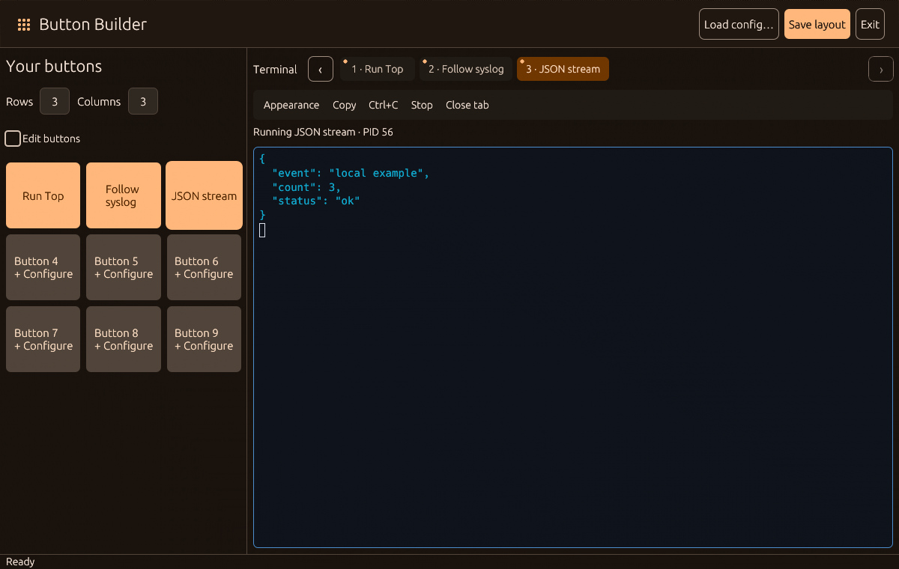

# Button Builder

A Linux desktop app for launching commands from a configurable button grid,
with interactive terminal tabs. Built with Rust 2024, egui, and egui-material3.
The Cargo package and executable are named `rs_button_builder` (version `0.1.0`).



GUI preview with generated sample output.

## Features

- Named YAML layouts with configurable grid dimensions, button labels, actions, and colors.
- Multiple process terminals with independent output, scrollback, fonts, and colors.
- Interactive commands, shell pipelines, and log following through Unix pseudo-terminals.
- Material controls with an orange accent and locally loaded fonts.

## Requirements

- Linux 5.3 or newer with X11 or Wayland and an OpenGL-capable graphics driver.
- Rust 1.88 or newer, Cargo, and a system C toolchain/linker to build from source.
- The executables used by your buttons and permission to read their input files.

## Dependencies

Direct Rust dependencies from [Cargo.toml](Cargo.toml):

| Dependency | Version requirement | Purpose |
| --- | --- | --- |
| `eframe` | `0.33` | Native window and OpenGL rendering, with X11 and Wayland support. |
| `egui` | `0.33.0` | GUI layout, widgets, and input handling. |
| `egui-material3` | `0.0.9` | Material controls and theme colors. |
| `serde` | `1.0` | Configuration serialization and deserialization. |
| `serde_yaml_ng` | `0.10` | YAML layout parsing and writing. |
| `libc` | `0.2` | Unix pseudo-terminals, process groups, and terminal sizing. |
| `shlex` | `2.0` | Parsing quoted program arguments. |
| `fontdb` | `0.23` | Discovering installed fonts and Fontconfig directories. |
| `ttf-parser` | `0.25` | Inspecting font glyph widths. |
| `unicode-width` | `0.2` | Unicode character widths for terminal cells. |
| `log` | `0.4` | Application logging. |
| `env_logger` | `0.11` | Logging configuration through `RUST_LOG`. |
| `dotenvy` | `0.15` | Loading environment variables from `.env`. |

Fonts and theme assets are loaded locally. Optional asset downloads in
`egui-material3` are disabled.

## Build and run

From the project directory:

```sh
cargo build --locked --release
./target/release/rs_button_builder
./target/release/rs_button_builder my-buttons.yaml
```

For development, Cargo can build and launch the GUI directly:

```sh
cargo run --locked
cargo run --locked -- my-buttons.yaml
cargo run --locked -- --help
```

`--help` prints command-line usage. The optional positional argument selects a YAML
layout file. Dependency versions are recorded in [Cargo.lock](Cargo.lock);
`--locked` preserves those versions.

## Usage

- **Configure buttons:** right-click a button, click an unassigned button, or enable
  **Edit buttons**. Set its label, executable, arguments, working directory, and colors.
  **Shell pipeline** runs the complete command through `/bin/sh`.
- **Customize layouts:** change **Rows** and **Columns**, or click the heading above
  the grid to rename the layout.
- **Manage terminals:** click a button to use the active terminal, or **Ctrl-click**
  to open another tab. Running tabs keep collecting output. Click the terminal to
  type; use the tab bar and its arrows to switch sessions.
- **Adjust appearance:** **Appearance** changes the selected tab's font and colors
  and the defaults for new tabs. **Refresh fonts** discovers installed monospace fonts.
- **Stop processes:** **Ctrl+C** sends `SIGINT` to the foreground job, allowing it
  to clean up; programs can ignore this signal. **Stop** sends `SIGKILL` and ends
  local jobs in that terminal session. Pending output is discarded; displayed output
  remains. **Close tab** uses the same forceful cleanup. **Exit** closes all tabs.
  Process cleanup runs off the UI thread, so it does not wait for a stalled child.

## Configuration and examples

The default layout file is `./buttons.yaml`. If it is missing, the app starts with
its built-in layout. An explicitly selected missing or invalid file reports an error.
**Load config…** selects a layout and makes it the destination for subsequent saves.
**Save layout**, **Save button**, and **Save appearance** write to that file;
unsaved changes are not automatically saved on exit.

A minimal layout:

```yaml
display_name: System Monitor
rows: 1
columns: 1
buttons:
  - label: Run Top
    command: /usr/bin/top
    arguments: -d 1
```

See [example layouts](examples/README.md) for system monitoring, JSON pipelines,
terminal demos, and following `/var/log/syslog`. Copy an example before customizing
it to preserve the original. JSON examples require `/usr/bin/jq`; log following
requires read access to the log file.

## Development

| Source | Responsibility |
| --- | --- |
| `src/main.rs`, `src/cli.rs` | Startup, arguments, logging, and `.env` loading. |
| `src/app.rs` | GUI, button editing, layouts, and terminal tabs. |
| `src/config.rs`, `src/config_picker.rs` | YAML persistence and layout selection. |
| `src/terminal/` | Pseudo-terminal processes, input, and screen rendering. |
| `src/ui.rs`, `src/fonts.rs` | Shared styling, bundled icons, and local font discovery. |

Run the checks before submitting changes:

```sh
cargo test --locked
cargo clippy --locked --all-targets -- -D warnings
cargo fmt --all -- --check
```

Tests use local Linux tools, including `/usr/bin/top` and `/usr/bin/jq`, and generated
input. They cover stalled input, ignored interrupts, raw terminal mode, continuous
output, and cleanup of background jobs. The log-follow test uses a temporary log file.
Keep changes focused and
include updated GUI screenshots when changing the interface.

Logging uses `RUST_LOG` (default: `info`). Startup loads an optional `.env` file;
child processes inherit the app's environment, including those values.

## Known limitations

Linux is the supported platform. The embedded terminal uses `TERM=vt100` and
supports ANSI colors, Unicode, and alternate screens. Terminal graphics, mouse
reporting, and full text reflow on width changes are not implemented.
Session cleanup uses Linux pidfd APIs to avoid targeting reused process IDs.
Jobs that detach into a new session and processes running on remote hosts can
require separate cleanup. A process stuck in uninterruptible kernel I/O can take
time to exit after `SIGKILL`; the UI does not wait for it.

## License

An application license has not yet been declared in [Cargo.toml](Cargo.toml).
The [bundled Material Symbols font](assets/README.md) is distributed under
[Apache License 2.0](licenses/Apache-2.0.txt); that license applies to the font asset.
